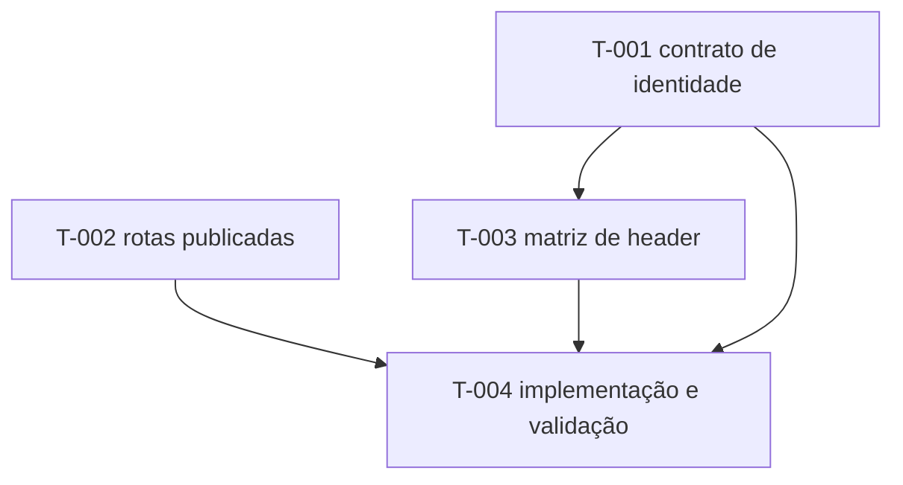

# TASK-PLAN v2 — controle de acesso por perfil

project: portal-de-cursos-website
plan_id: tads-184-controle-acesso
plan_version: 1
canonical_source: docs/controle-de-acesso/TASK-PLAN.md
dashboard_target: não solicitado
status: blocked
owner_role: planner
created_at: 2026-10-19
updated_at: 2026-10-19

> **Status:** este é um plano, não uma implementação. Nenhuma tarefa de código está pronta enquanto os alarmes A-AUTH-001 e A-DEPLOY-001 estiverem ativos.

## Feature Layer

feature_id: controle-acesso-por-perfil
feature_title: Navegação pública e áreas protegidas por perfil
rationale: Corrigir a exposição de ações privadas, remover duplicações do header e tornar a rota privada segura desde a URL direta.
priority: P1
status: blocked
goal: Navegação clara por perfil e guarda de rota baseada em identidade autenticada pelo servidor.
scope_in:
- Header público e autenticado.
- Matriz de visibilidade por papel.
- Retorno interno após login.
- Guarda de rota e fallback de deploy.
scope_out:
- Alterações no backend usuarioService.
- Novos endpoints sem aprovação da equipe responsável.
- Publicação de cursos, projetos, perfil ou submissões.
changed_subsystems:
- Header compartilhado.
- Roteamento do SPA.
- Cliente de autenticação.
- Workflow GitHub Pages.
constraints:
- Frontend somente.
- NO-MOCKS e NO-PLACEHOLDERS para tarefas executáveis.
- Não confiar em e-mail ou JWT decodificado para conceder autorização.
assumptions:
- A API segue como autoridade de autorização.
open_questions:
- Ver `A-AUTH-001` e `A-DEPLOY-001`.
risks:
- Mostrar conteúdo incorreto durante restauração de sessão.
- Criar rota publicada que retorna 404 antes da guarda.
regression_risks:
- Login, tema, navegação hash pública, perfil, teclado e links de retorno.
security_privacy_notes:
- Token não pode aparecer em documentação, captura, URL ou log.
non_functional_requirements:
- Teclado, foco visível, redução de movimento e largura mínima de 320 px.
milestones:
- Decisão de contrato de identidade.
- Matriz aprovada.
- Implementação e validação em produção.
timebox: TBD após resolver bloqueadores.
wiki_pages_to_read_before:
- docs/controle-de-acesso/FEATURE-PREPARATION.md
- docs/autenticacao-professor.md
- docs/regras-interface.md
wiki_pages_to_update_after:
- docs/autenticacao-professor.md
- docs/regras-interface.md
wiki_facts_to_capture:
- Contrato escolhido para identidade.
- Rotas publicadas e estratégia de fallback.
- Evidências executadas sem dados pessoais.
wiki_do_not_store:
- secrets
- tokens
- e-mails reais
- dados pessoais

## Pre-Implementation Gate

feature_preparation_path: docs/controle-de-acesso/FEATURE-PREPARATION.md
preimplementation_status: blocked
entry_rule: Nenhuma tarefa de implementação pode mudar para ready enquanto A-AUTH-001 e A-DEPLOY-001 estiverem ativos.

## Active Alarms

feature_active_alarms:
- A-AUTH-001
- A-DEPLOY-001
feature_resolved_alarms:
- none

## Execution Policy

orchestration_mode: sequential
default_agent_sequence:
- planner
- implementer
- reviewer
- tester
- docs_sync
status_legend:
- draft
- ready
- in_progress
- blocked
- needs_review
- approved
- done
- dropped

## Execution Governance

mode: NO-FICTION, ONE-TASK-ONLY, CODE-FIRST
no_fiction_policy: Decisões de API e deploy ausentes permanecem explícitas; não inventar endpoint, permissão, evidência ou rota publicada.
mock_policy: Não usar simulação de autenticação para validar aceite de produção.
placeholder_policy: TBD crítico bloqueia execução; todo placeholder é um alarme estruturado.
prompt_policy: Uma tarefa por prompt; o prompt inclui escopo, fora de escopo, estratégia de verificação e alarmes ativos.
code_first_policy: Documentação sozinha fecha apenas tarefas de planejamento, nunca implementação.
done_policy: Dependências resolvidas, aprovações, testes executados, evidências, rollback e atualização documental são obrigatórios.
rollback_policy: Reverter o conjunto de navegação/guarda ou fazer correção progressiva; não invalidar token no backend.
timeout_escalation_policy: Após duas rodadas de revisão sem contrato de identidade, escalar ao responsável de produto/API.

## Verification Policy

verification_planning_rule: O planejador fixa os cenários; revisor confere o contrato; tester executa em API homologada e ambiente publicado.
critical_verification_fields:
- tests_required
- test_levels
- test_targets
- oracle
- negative_tests
- commands_planned
test_level_enum:
- integration
- e2e
- smoke
- manual-check-needed
planned_vs_executed_rule: comandos planejados não são evidência até serem executados e registrados.
failure_rule: qualquer falha de autorização, URL direta ou teclado bloqueia docs_sync.

## Task Register

| task_id | title | status | priority | owner_role | depends_on | required_approvals |
| --- | --- | --- | --- | --- | --- | --- |
| T-001 | Fechar contrato de identidade autenticada | blocked | P1 | product_owner | [A-AUTH-001] | [api-contract-review] |
| T-002 | Fechar estratégia de rotas diretas publicadas | blocked | P1 | devops_owner | [A-DEPLOY-001] | [deploy-review] |
| T-003 | Especificar matriz de header por perfil | draft | P1 | planner | [T-001] | [ux-review] |
| T-004 | Implementar e validar header e guardas | blocked | P1 | implementer | [T-001, T-002, T-003] | [code-review, qa-signoff] |

## Tasks

### TASK T-001

task_id: T-001
title: Fechar contrato de identidade autenticada
rationale: A rota não consegue restaurar com segurança uma sessão sem uma fonte individual de identidade e papel.
priority: P1
status: blocked
owner_role: product_owner
active_alarm_ids:
- A-AUTH-001
dependencies: []
blocked_by:
- A-AUTH-001
unblocks:
- T-003
- T-004
task_size: S
goal: Documentar e aprovar o contrato real que retorna a identidade da própria sessão.
scope_in:
- Resposta de login ou endpoint autenticado de identidade.
- Campos mínimos e erros de token expirado/inválido.
scope_out:
- Alterar o usuarioService nesta tarefa de planejamento.
candidate_files:
- docs/controle-de-acesso/FEATURE-PREPARATION.md
- docs/autenticacao-professor.md
forbidden_areas:
- Tokens, senhas e dados pessoais em documentação.
acceptance_criteria:
- Há fonte oficial para id, nome, email e tipoUsuario da sessão atual.
- Há resposta definida para token ausente, inválido e expirado.
- O contrato não exige listar outras contas para encontrar a própria.

#### Verification Strategy

tests_required: manual-check-needed
test_levels:
- integration
test_targets:
- Contrato da API autenticada.
test_data_origin: Conta de homologação autorizada.
oracle: A chamada retorna apenas a identidade autorizada da conta autenticada e responde 401/403 conforme contrato.
negative_tests:
- Bearer ausente.
- Bearer inválido.
- Bearer expirado.
commands_planned:
- TBD após definição da API.
commands_run: []

#### Agent Contracts

##### A1
agent_id: A1
role: planner
entry_criteria:
- Responsável de API disponível.
input_artifacts:
- FEATURE-PREPARATION.md
steps:
- Registrar decisão de contrato e campos mínimos.
output_artifacts:
- Contrato aprovado no documento técnico.
handoff_to: A2
approval_gate:
- api-contract-review
stop_conditions:
- Sem decisão do responsável de API.

##### A2
agent_id: A2
role: reviewer
entry_criteria:
- Contrato proposto.
input_artifacts:
- Contrato proposto.
steps:
- Confirmar que o contrato não expõe lista de contas desnecessariamente.
output_artifacts:
- Parecer de contrato.
handoff_to: T-003
approval_gate:
- api-contract-review
stop_conditions:
- Sem semântica de token inválido/expirado.

### TASK T-002

task_id: T-002
title: Fechar estratégia de rotas diretas publicadas
rationale: A guarda só executa se a aplicação carregar na URL privada.
priority: P1
status: blocked
owner_role: devops_owner
active_alarm_ids:
- A-DEPLOY-001
dependencies: []
blocked_by:
- A-DEPLOY-001
unblocks:
- T-004
task_size: S
goal: Garantir que cada rota privada prevista entregue o SPA antes da guarda.
scope_in:
- Workflow de Pages e convenção de URLs privadas.
scope_out:
- Alterar código de aplicação antes da decisão.
candidate_files:
- .github/workflows/pages.yml
acceptance_criteria:
- Cada URL privada prevista abre o SPA em nova aba.
- Em ausência de sessão, todas redirecionam ao login.
- O fallback não mascara erro de asset estático.

#### Verification Strategy

tests_required: yes
test_levels:
- smoke
- manual-check-needed
test_targets:
- URL publicada de professor e administração, em sessão ausente.
test_data_origin: Ambiente de preview autorizado.
oracle: HTTP entrega a aplicação e a guarda exibe login sem conteúdo da área privada.
negative_tests:
- Rota administrativa inexistente.
- Asset inexistente.
commands_planned:
- Abrir cada rota em janela anônima no ambiente publicado.
commands_run: []

### TASK T-003

task_id: T-003
title: Especificar matriz de header por perfil
rationale: A fonte atual mostra links privados ao visitante e repete Administração no menu e nas ações.
priority: P1
status: draft
owner_role: planner
active_alarm_ids:
- A-AUTH-001
dependencies:
- T-001
blocked_by:
- A-AUTH-001
unblocks:
- T-004
task_size: S
goal: Aprovar conteúdos, ordem, rótulos, estados ativos e comportamento móvel do header.
scope_in:
- Header público e autenticado.
- `Entrar`, foto/nome, tema e acesso contextual por papel.
scope_out:
- Sidebar administrativa interna.
candidate_files:
- src/shared/components/header/Cabecalho.jsx
- src/shared/components/header/cabecalho.css
- docs/regras-interface.md
acceptance_criteria:
- Matriz da preparação é a única fonte de visibilidade do header.
- Não existe duplicação de Administração, Área do Professor ou Submeter projeto.
- Ações à direita se mantêm acessíveis em 320 px.

#### Verification Strategy

tests_required: yes
test_levels:
- e2e
- manual-check-needed
test_targets:
- Visitante, professor e administrador em desktop e celular.
test_data_origin: Contas de homologação autorizadas.
oracle: Inspeção do DOM e captura confirmam exatamente os links da matriz aprovada.
negative_tests:
- Perfil não reconhecido.
- Menu móvel fechado/aberto.
commands_planned:
- Executar cenário de navegação por perfil e captura em 320 px, 390 px e desktop.
commands_run: []

### TASK T-004

task_id: T-004
title: Implementar e validar header e guardas
rationale: Aplicar a matriz aprovada sem fragilizar login, retorno, tema ou navegação pública.
priority: P1
status: blocked
owner_role: implementer
active_alarm_ids:
- A-AUTH-001
- A-DEPLOY-001
dependencies:
- T-001
- T-002
- T-003
blocked_by:
- A-AUTH-001
- A-DEPLOY-001
unblocks: []
task_size: M
goal: Entregar cabeçalho contextual e guarda testada em produção.
scope_in:
- Header, rotas, sessão e workflow aprovados nos três itens anteriores.
scope_out:
- Backend, permissões do servidor e funcionalidades de gestão não relacionadas.
candidate_files:
- src/shared/components/header/Cabecalho.jsx
- src/shared/components/header/cabecalho.css
- src/app/Aplicacao.jsx
- src/app/rotas.js
- src/api/v1/autenticacao.js
- src/api/v1/usuarios.js
- .github/workflows/pages.yml
forbidden_areas:
- usuarioService
- Persistência de token sem revisão de segurança.
acceptance_criteria:
- Critérios da FEATURE-PREPARATION atendidos.
- Nenhuma rota privada exibe conteúdo antes da validação de sessão.
- O backend continua sendo a autoridade final.
rollback_plan: Reverter o commit do frontend/workflow ou encaminhar correção progressiva; não modificar dados e não invalidar contas.

#### Verification Strategy

tests_required: yes
test_levels:
- integration
- e2e
- smoke
- manual-check-needed
test_targets:
- Login, restauração de sessão, retorno interno, rotas cruzadas, header, teclado e URLs publicadas.
test_data_origin: Contas de homologação autorizadas e dados sintéticos sem informações pessoais.
oracle: Cada cenário chega ao destino permitido ou login, sem conteúdo privado, duplicação de link ou overflow global.
negative_tests:
- URL de retorno externa.
- Token inválido/expirado.
- Professor em administração.
- Administrador em área do professor.
- Visitante em todas as rotas privadas.
commands_planned:
- npm run check
- Teste de navegador dos três papéis em 320 px, 390 px e desktop.
- Smoke das URLs publicadas em janela anônima.
commands_run: []

#### Agent Contracts

##### A1
agent_id: A1
role: implementer
entry_criteria:
- T-001, T-002 e T-003 aprovadas.
input_artifacts:
- Matriz de header aprovada.
- Contrato de identidade aprovado.
- Estratégia de deploy aprovada.
steps:
- Implementar somente o escopo aprovado.
- Registrar alterações e alarmes resolvidos.
output_artifacts:
- Diff de frontend/workflow.
handoff_to: A2
approval_gate:
- code-review
stop_conditions:
- Contrato diverge da API ou exigência expande escopo.

##### A2
agent_id: A2
role: reviewer
entry_criteria:
- Diff disponível.
input_artifacts:
- Diff e plano.
steps:
- Conferir isolamento por papel, retorno e limites de segurança.
output_artifacts:
- Parecer de revisão.
handoff_to: A3
approval_gate:
- code-review
stop_conditions:
- Rota libera conteúdo antes da validação.

##### A3
agent_id: A3
role: tester
entry_criteria:
- Code review aprovado.
input_artifacts:
- Diff e cenários planejados.
steps:
- Executar verificações planejadas e registrar evidência real.
output_artifacts:
- Relatório de testes.
handoff_to: A4
approval_gate:
- qa-signoff
stop_conditions:
- Falha de rota, sessão ou teclado.

##### A4
agent_id: A4
role: docs_sync
entry_criteria:
- qa-signoff concedido.
input_artifacts:
- Relatório de testes.
steps:
- Atualizar documentos de contrato e registrar comandos executados.
output_artifacts:
- Documentação sincronizada.
handoff_to: none
approval_gate:
- completion-signoff
stop_conditions:
- Evidência ausente ou alarme ainda ativo.

## Dependency Graph

